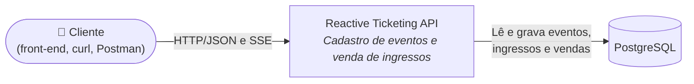
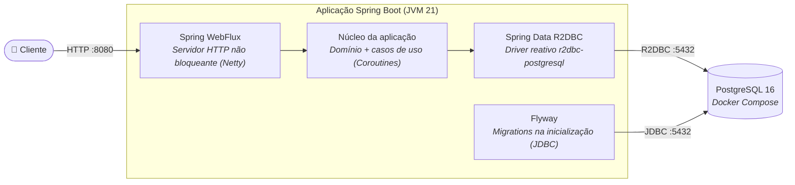
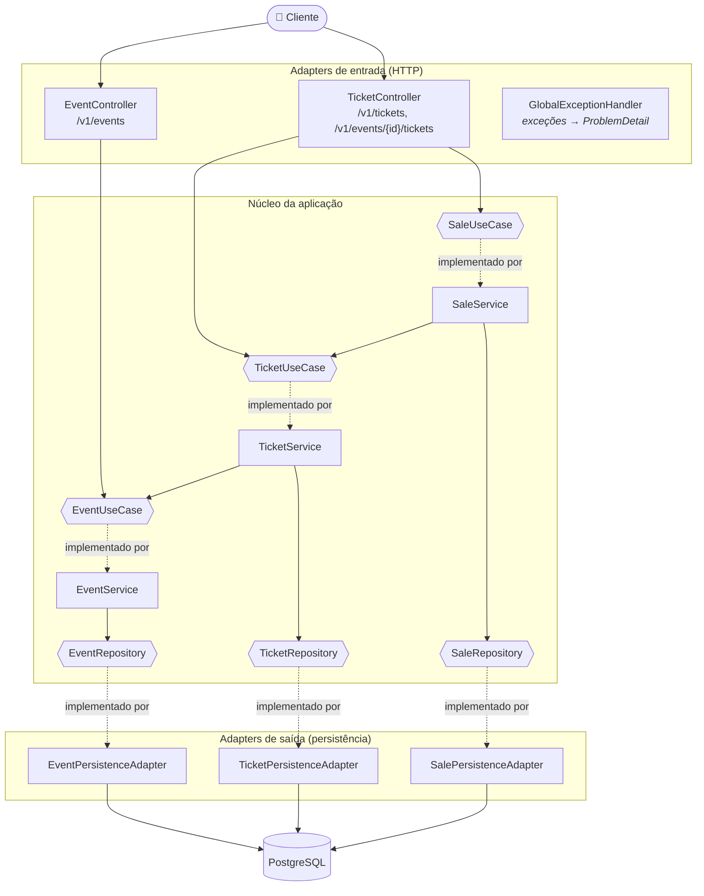

# Arquitetura

[← Voltar ao README](../README.md)

## Visão geral

A aplicação é um único serviço Spring Boot reativo (WebFlux + Kotlin Coroutines) que persiste dados em um PostgreSQL via R2DBC. O schema do banco é versionado com Flyway.

O código segue **arquitetura hexagonal (ports & adapters)**: o núcleo da aplicação (domínio e casos de uso) não conhece HTTP nem banco de dados. Ele expõe **portas de entrada** (interfaces de caso de uso) e depende de **portas de saída** (interfaces de repositório). Os **adapters** fazem a ponte com o mundo externo.

## Diagramas C4

### Nível 1 — Contexto



### Nível 2 — Contêineres



O Flyway não tem suporte a R2DBC, por isso usa uma conexão JDBC separada apenas para rodar as migrations (configurada em `spring.flyway.*` no `application.yaml`). Todo o resto do acesso ao banco é reativo.

### Nível 3 — Componentes



Hexágonos (`{{ }}`) são portas (interfaces); retângulos são implementações. O `SaleService` depende do `TicketUseCase` (e não do repositório de tickets) para reaproveitar a regra de baixa de estoque. Da mesma forma, o `TicketService` usa o `EventUseCase` para validar que o evento existe antes de criar um ingresso.

## Camadas e responsabilidades

Cada módulo (`event`, `ticket`) tem a mesma estrutura dentro de `src/main/kotlin/dev/rogerbertan/reactive_ticketing_api/`:

| Camada             | Pacote                    | Responsabilidade                                                            | Exemplos                                                               |
|--------------------|---------------------------|-----------------------------------------------------------------------------|------------------------------------------------------------------------|
| Domínio            | `application/domain`      | Modelos e regras de negócio puras, exceções de domínio                      | `Ticket.sell()`, `Ticket.addTickets()`, `InsufficientTicketsException` |
| Porta de entrada   | `application/port/in`     | Interfaces dos casos de uso e seus *commands* (dados de entrada)            | `TicketUseCase`, `CreateSaleCommand`                                   |
| Serviço            | `application/service`     | Implementa os casos de uso e define as transações (`@Transactional`)        | `TicketService`, `SaleService`                                         |
| Porta de saída     | `application/port/out`    | Interfaces que o núcleo usa para persistir dados                            | `TicketRepository`, `SaleRepository`                                   |
| Adapter de entrada | `adapter/in/http`         | Controllers, DTOs de request/response, validação e mapeamento DTO → command | `TicketController`, `TicketRequest`, `TicketHttpMapper.kt`             |
| Adapter de saída   | `adapter/out/persistence` | Entidades R2DBC, repositórios Spring Data e mapeamento entidade ↔ domínio   | `TicketEntity`, `TicketR2dbcRepository`, `TicketPersistenceAdapter`    |

O módulo `shared` contém o `GlobalExceptionHandler`, que converte exceções de domínio em respostas `ProblemDetail` (RFC 9457).

### Fluxo de dados entre camadas

```
Request JSON → DTO (Request) → Command → Service → Domínio → Port out → Entity → Banco
Banco → Entity → Domínio → DTO (Response) → JSON
```

O mapeamento é feito com *extension functions* Kotlin (`toCommand()`, `toResponse()`, `toDomain()`, `toEntity()`), mantendo as camadas desacopladas.

## Modelo reativo

- **WebFlux + Coroutines:** os controllers usam funções `suspend` (respostas únicas) e `Flow<T>` (streams). O Spring adapta isso automaticamente para `Mono`/`Flux` sobre o Netty, sem bloquear threads.
- **R2DBC:** os repositórios estendem `CoroutineCrudRepository`, então leituras e escritas também são não bloqueantes.
- **Transações reativas:** `@Transactional` funciona em funções `suspend` e `Flow`, usando o `R2dbcTransactionManager`.
- **Atualizações em tempo real (SSE):** cada controller mantém um `MutableSharedFlow` em memória. Quando algo muda (evento criado, ingresso criado/reposto/vendido), o controller emite o novo estado nesse flow. Os endpoints SSE fazem `merge` entre os dados atuais do banco e esse flow, então quem está conectado recebe as mudanças à medida que acontecem. Detalhes em [Fluxos](flows.md).

> Como o `MutableSharedFlow` vive na memória da instância, as atualizações SSE só chegam a clientes conectados à mesma instância da aplicação. Para rodar várias instâncias seria necessário um broker (ex.: Redis Pub/Sub, Kafka ou `LISTEN/NOTIFY` do PostgreSQL).