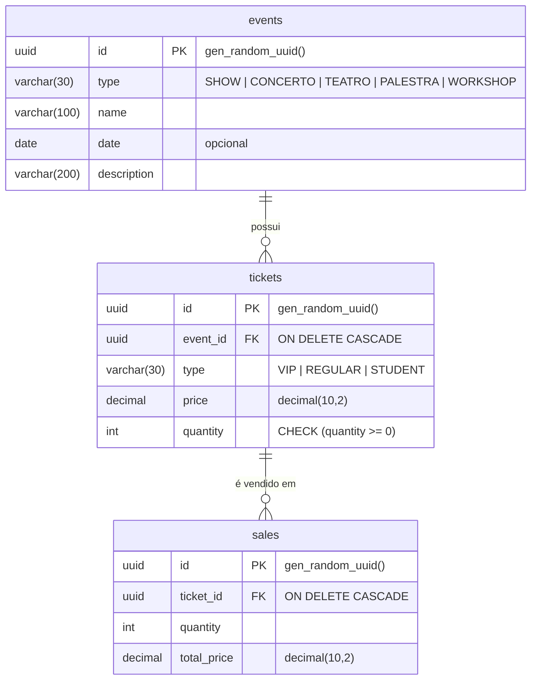

# Banco de dados

[← Voltar ao README](../README.md)

PostgreSQL 16, com schema versionado pelo Flyway. As migrations ficam em `src/main/resources/db/migration/` e rodam automaticamente quando a aplicação sobe.

## Modelo de dados



- **events** — os eventos (shows, peças, palestras etc.).
- **tickets** — cada linha é um *tipo* de ingresso de um evento (ex.: VIP do show X), com preço e quantidade em estoque.
- **sales** — histórico de vendas: quantos ingressos foram vendidos e o valor total.

### Regras no banco

- IDs são gerados pelo próprio PostgreSQL (`gen_random_uuid()`).
- Remover um evento remove seus ingressos, e remover um ingresso remove suas vendas (`ON DELETE CASCADE`).
- `tickets.quantity` nunca fica negativo (`CHECK (quantity >= 0)`), uma proteção extra contra venda acima do estoque. Veja [Controle de concorrência](flows.md#controle-de-concorrência).

## Migrations

| Versão | Arquivo                          | O que faz                                   |
|--------|----------------------------------|---------------------------------------------|
| V001   | `V001__create_table_events.sql`  | Cria a tabela `events`                      |
| V002   | `V002__insert_table_events.sql`  | Insere 14 eventos de exemplo                |
| V003   | `V003__create_table_tickets.sql` | Cria a tabela `tickets`                     |
| V004   | `V004__insert_table_tickets.sql` | Insere ingressos de exemplo para os eventos |
| V005   | `V005__create_table_sales.sql`   | Cria a tabela `sales`                       |

Para criar uma nova migration, adicione um arquivo seguindo o padrão `V<NNN>__<descricao>.sql` com o próximo número. Não altere migrations que já rodaram: o Flyway valida o checksum e a aplicação não sobe se ele mudar.

## Dados de exemplo

Alguns eventos inseridos pelas migrations, úteis para testar a API:

| ID                                     | Tipo     | Nome                                   | Ingressos             |
|----------------------------------------|----------|----------------------------------------|-----------------------|
| `3fdfdfd5-f757-495a-a346-a62c1347b919` | SHOW     | Taylor Swift                           | VIP, REGULAR, STUDENT |
| `84c5e4a8-006b-4a08-b64b-42c876c2de29` | SHOW     | Bruno Mars                             | VIP, REGULAR, STUDENT |
| `c529a1e6-7cfc-4927-9b60-46377c6bc0e5` | SHOW     | The Weeknd                             | VIP, REGULAR          |
| `99715e18-efe3-40c7-b1fe-8e1fd79f275e` | TEATRO   | A Comédia da Vida                      | REGULAR, STUDENT      |
| `5c3eccc2-c1c8-4831-899d-addc095f1397` | CONCERTO | Concerto de Verão                      | VIP, REGULAR          |
| `9654d365-cc1e-42c1-b9f1-559d8b799623` | PALESTRA | Palestra sobre Inteligência Artificial | REGULAR, STUDENT      |
| `60a46af3-2eef-48c7-b2f1-87a0b9e7bf52` | WORKSHOP | Workshop de Fotografia                 | REGULAR               |

A lista completa está em `V002__insert_table_events.sql` e `V004__insert_table_tickets.sql`. Os IDs dos ingressos são gerados na inserção; consulte-os pelo endpoint `GET /v1/events/{eventId}/tickets`.

## Acessando o banco

Com o container rodando:

```bash
docker compose exec postgres psql -U postgres -d ticketing
```

```sql
SELECT e.name, t.type, t.price, t.quantity
FROM tickets t JOIN events e ON e.id = t.event_id
ORDER BY e.name;
```

## Resetando os dados

Para voltar ao estado inicial (apaga o volume e roda todas as migrations de novo no próximo start):

```bash
docker compose down -v
docker compose up -d
./gradlew bootRun
```