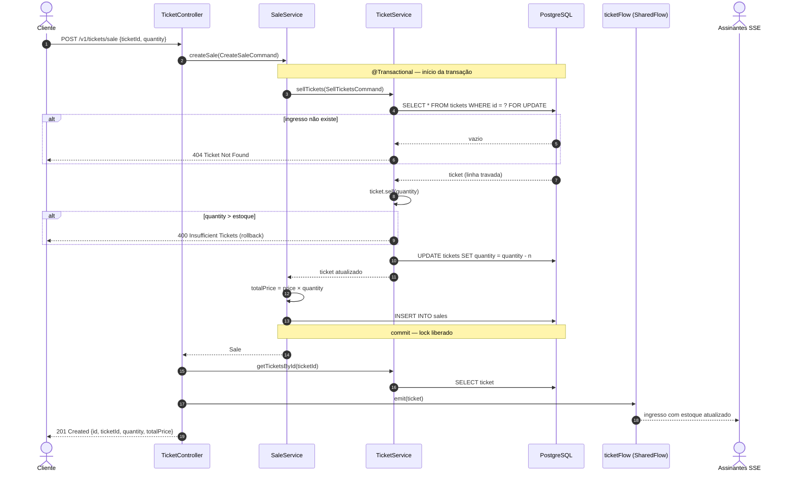
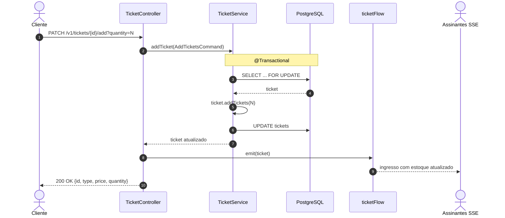
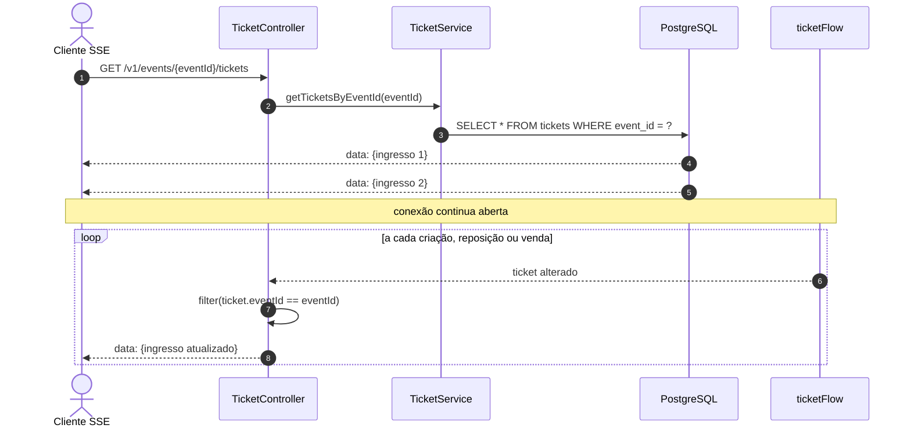
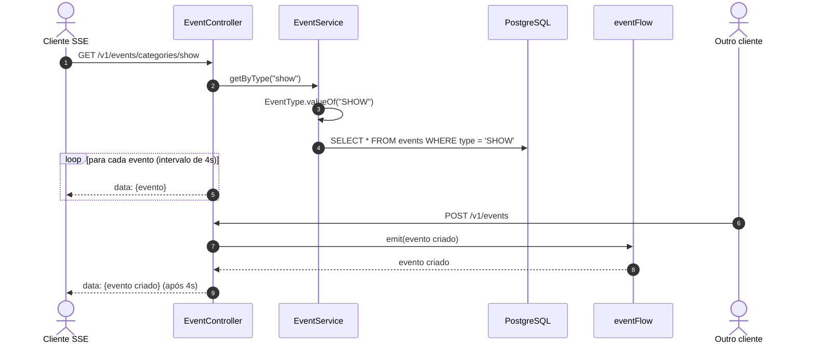
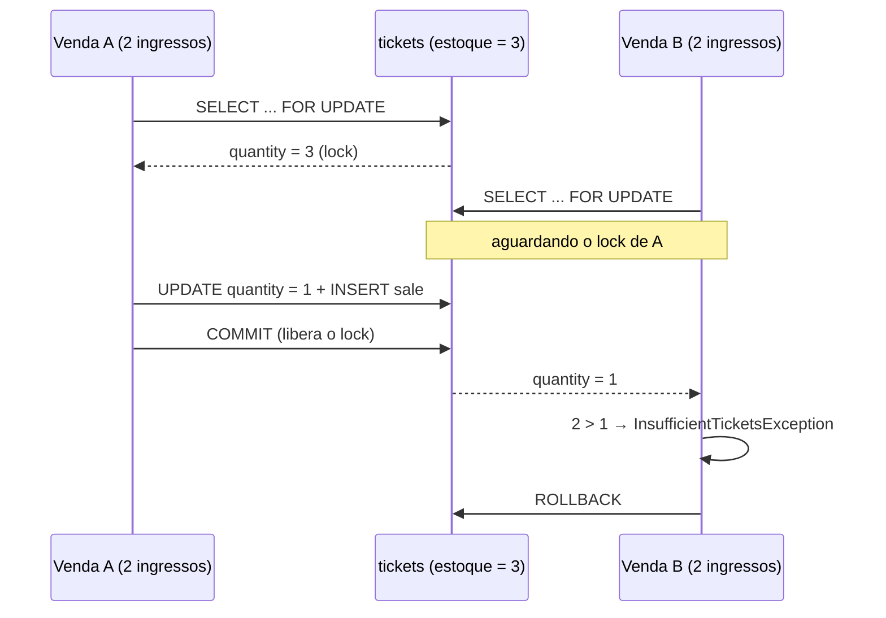

# Fluxos

[← Voltar ao README](../README.md)

Diagramas de sequência dos principais fluxos da aplicação.

## Venda de ingressos

`POST /v1/tickets/sale`

A venda reduz o estoque do ingresso e registra uma linha na tabela `sales`, tudo na mesma transação. O ingresso é travado com `SELECT ... FOR UPDATE` para que vendas simultâneas não vendam o mesmo estoque duas vezes.

## Reposição de ingressos

`PATCH /v1/tickets/{id}/add?quantity=N`

A criação de um novo tipo de ingresso (`POST /v1/tickets`) segue o mesmo padrão: salva no banco e emite o ingresso criado no `ticketFlow`.

## Stream de ingressos de um evento (SSE)

`GET /v1/events/{eventId}/tickets` — `Content-Type: text/event-stream`

O resultado é um `merge` entre o snapshot atual do banco e o `ticketFlow` filtrado pelo evento. O cliente recebe primeiro o estado atual e depois cada mudança.

## Stream de eventos por categoria (SSE)

`GET /v1/events/categories/{type}` — `Content-Type: text/event-stream`

Pontos de atenção:

- Existe um `delay` de 4 segundos antes de cada item, para deixar o comportamento de streaming visível.
- O `eventFlow` **não** é filtrado por categoria: quem está assinando `/categories/show` também recebe eventos novos de outras categorias.

## Controle de concorrência

Duas vendas simultâneas do mesmo ingresso poderiam ler o mesmo estoque e as duas "passarem" na validação. A aplicação evita isso com duas camadas:

1. **Lock pessimista na linha:** `TicketR2dbcRepository.findByIdForUpdate` executa `SELECT * FROM tickets WHERE id = :id FOR UPDATE` dentro da transação. A segunda transação espera a primeira terminar e só então lê o estoque já atualizado. Vale para venda e reposição.
2. **Constraint no banco:** a coluna `tickets.quantity` tem `check (quantity >= 0)`. Mesmo que algum caminho de código escape da validação, o banco rejeita estoque negativo.

